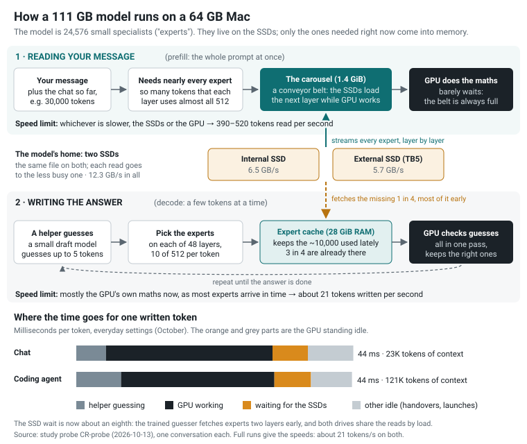
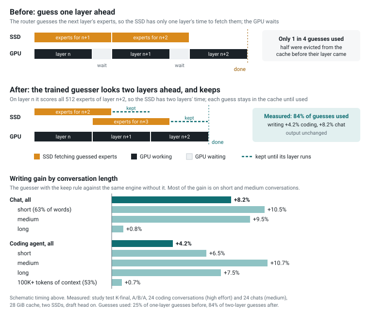
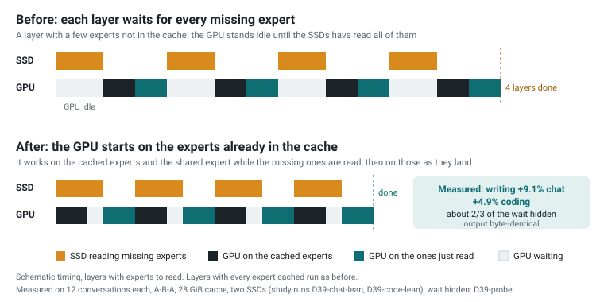
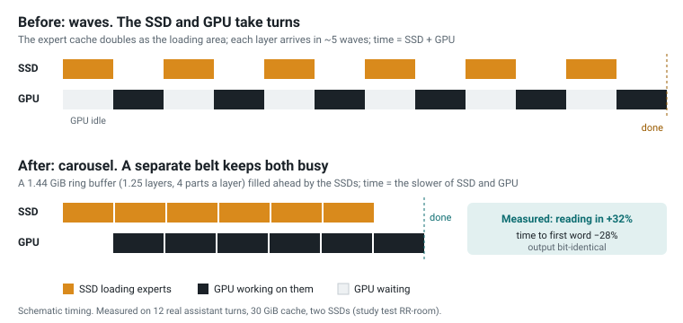
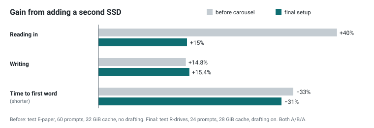
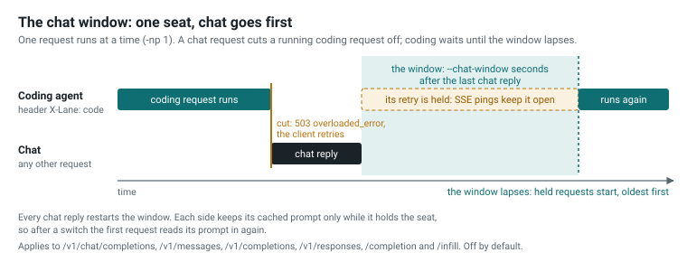
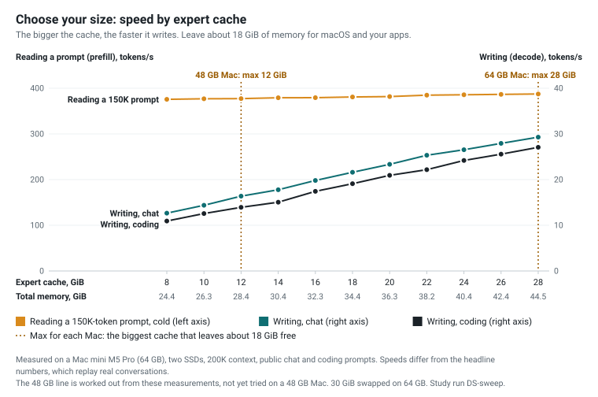

# Flash-Next SSD

**Run Qwen3.8-Flash-Next, a 111 GB model, on a 64 GB or 48 GB Mac.**

This is a [llama.cpp](https://github.com/ggml-org/llama.cpp) fork for Apple Silicon. The model is a
mixture of experts: 48 layers of 512 experts, and each token uses only 10 experts on each layer. So
the experts stay on the SSD. The ones a token needs are read in as it is computed, and the ones used
lately stay in an expert cache in RAM. Everything else stays resident on the GPU.

It was tuned for a Mac mini M5 Pro with 64 GB and a second SSD over Thunderbolt 5. The tuning was
measured on real chat and coding-agent conversations, and any timing that swap touched was thrown out.
On a 48 GB Mac, see [Choose your size](#choose-your-size) for the speeds to expect.

<p align="center"></p>

## Headline numbers

Measured on a Mac mini M5 Pro (64 GB) with Unsloth's UD-Q4_K_XL quant, a 28 GiB expert cache, two
SSDs, the DFlash draft and both trained guessers on ([what each extra is worth](#what-each-extra-is-worth)).
Sources and method are in [Results](docs/flashnext/results.md).

The writing speeds come from two sets of the author's own work, each replayed turn by turn:
coding-agent conversations at high thinking effort, and chat conversations at medium effort.

| | |
|---|---|
| **Writing (decode), coding agent** | **26.5 tokens/s** |
| **Writing (decode), chat** | **29.3 tokens/s** |
| **A new chat while a coding agent works** | **3.5-4.1 s** to the first token, from 14.2 s: the chat's opening comes back from RAM instead of being read in again, also when the agent had the server first |
| **Reading a prompt (prefill)** | **523 / 430 / 391 tokens/s** at 4K / 32K / 100K tokens, from cold |
| **Quality** | **18/20** on a fixed 20-task exam, the same score as the plain setup (sat with the MTP draft head: a draft only suggests tokens, and the model checks every one) |

## What it adds

### SSD expert streaming with an expert cache

`--moe-stream` keeps the routed experts on the SSD and holds a fixed-size expert cache in RAM
(`--moe-stream-cache 28` = 28 GiB). Reads skip macOS's file cache (`--moe-stream-direct`), so the
cache and the rest of the system keep their memory, and many reads run at once.

At 28 GiB about 4 in 5 of the experts a token needs are already in the cache. The rest are read from
the SSD: some fetched early by the lookahead (below), the others when their layer asks for them. When the cache is full, it lets go of
the expert that has gone longest without being used (least recently used, LRU; the rule comes from
Marian Mihailescu's GPU slot-resolution work). So the cache follows the conversation as its topic
moves, and it reads 17-28% fewer experts per written token than the older rule.
`LLAMA_MOE_STREAM_LRU=0` switches back to that rule, which lets go of the expert with the lowest
recent use count.

### The lookahead: two trained guessers

While the GPU works on one layer, the engine fetches the experts it expects the next layers to pick,
so they are in the cache by the time they are needed. Two small guessers on
[crystal-ball](https://huggingface.co/skeggsguy/crystal-ball) make those guesses. Each was trained on
the model's own routing while it wrote real replies:

- The two-layer guesser looks two layers ahead, which gives the SSDs two layers' time to fetch.
- The one-layer guesser tops those up a layer ahead.

A guessed expert stays in the cache until its layer has run (the keep rule). About 84% of the
two-layer guesses and 65-71% of the one-layer guesses are used.

Together they make writing **about 12% faster on coding and 16% faster on chat** than the engine's
built-in guess. The built-in guess looks one layer ahead, and only about 1 in 4 of its fetches is
used. It is what runs if you don't download the guessers.

<p align="center"></p>

### The GPU starts on the experts already in the cache

At each layer, most of the experts a token needs are in the cache, and a few may still be on their
way from the SSDs. The GPU doesn't wait for those. It starts at once on the cached experts and the
shared expert, then works on the rest as they land. That hides about two thirds of the wait for
missing experts. Writing is **9.1% faster on chat and 4.9% faster on coding** than waiting for every
expert first.

Each expert's maths is unchanged, so the output is byte-identical. `LLAMA_MOE_STREAM_DESK_FIRST=0`
makes each layer wait for all its experts first.

<p align="center"></p>

### The reading room: a carousel for long prompts

A long prompt needs nearly every expert on every layer. The reading room is a small ring buffer
(about 1.4 GiB) carved out of the expert cache. The SSDs fill it layer after layer, ahead of the
GPU, so prompt reading costs whichever of the two is slower, not both added together. The output
is byte-identical to having every expert in RAM. While a reply is written, the buffer is lent back
as extra cache, which wins back its cost (+5.5% writing). It is on by default.

<p align="center"></p>

### Two drives

Put a byte-identical copy of the model on a second SSD (`--moe-stream-alt-path`) and the two drives
share the expert reads. Each read goes to the drive with fewer reads in flight; when both are equally
busy, `--moe-stream-alt-split 53` decides (53% of experts from the internal copy). The internal SSD
(6.5 GB/s) and a 990 PRO over Thunderbolt 5 (5.7 GB/s) give 12.3 GB/s together. The second drive
made writing 15% faster and cut the time to first token by 31%.

<p align="center"></p>

### The DFlash draft, with the chain stop

A small draft model, Inco AI's DFlash 2, guesses up to 7 tokens in one pass: it fills in the whole
block together (block diffusion) instead of one token after another. The model then checks them all
in one pass. Every guess, right or wrong, needs its own experts fetched, so the chain stop ends a
draft early: once the draft's own estimate that all its tokens so far are right falls under 0.5, it
stops guessing. The guessing takes 3.3-3.4 ms for each token written, against 7.4-8.2 ms with the
MTP draft head below.
Writing is **10.8% faster on chat and 8.7% faster on coding** than with the MTP draft head. Give its
file to `-md`, and `--flashnext` sees from the file that it is DFlash (`--spec-type draft-dflash`).

The alternative is npanj's MTP draft head, which guesses up to 5 tokens ahead at a depth it measures
for itself: writing 23% faster on agent work (tool calls, code) than with no draft.

### Union attention

The model's sparse attention picks the context blocks each query attends to. Union attention
shares one deduplicated pick list per batch while reading a prompt. At 160K context its working
memory drops from 5.6 GiB to 1.9 GiB, and prompt reading gets 5% faster. It sums in a different
order, so words can differ at near-ties; perplexity is unchanged. It is the default
(`LLAMA_QSA_UNION=1`).

### The chat window

One server, two users: you chatting, and a coding agent working in the background. A chat request
stops a running background request, which gets a 503 that its client retries. Background requests
then wait until 90 seconds after the last chat reply. Only the background client needs to send a
header (`X-Lane: code`). `--flashnext` turns it on at 90 s (`--chat-window 90`); with no such client
it changes nothing.

<p align="center"></p>

### And smaller wins, all on by default

- The n-gram table's hot rows sit on a 128 MiB shelf instead of macOS's file cache (`--ple-shelf`, +3% writing).
- One prompt-cache checkpoint stays pinned at the start of the conversation, so a new chat after a
  long one resumes in 4 s instead of 14 s.
- Cheaper per-layer stops: less locking and lookup at each layer, the next layer's GPU work encoded
  ahead, and a tiny keep-awake ping so the GPU does not power down while it waits (+7% writing).

## Quick start

### Choose your size

<p align="center"></p>

The expert cache is the biggest speed setting: the bigger it is, the faster the model writes. But it
shares memory with macOS and your apps. **The basic setup needs about 18 GiB left free to stay clear
of swap.** That is what a 64 GB Mac with a browser and a few light apps open needed: a 28 GiB cache
left about 19.5 GiB free and ran clean, and a 30 GiB cache swapped as it opened. Leave more if you
run heavy apps.

| Mac memory | Biggest cache | Writing, chat | Writing, coding |
|---|---|---|---|
| 48 GB | 12 GiB | 16.4 tokens/s | 13.9 tokens/s |
| 64 GB | 28 GiB | 29.3 tokens/s | 27.1 tokens/s |

The 48 GB row is worked out from the 64 GB measurements; it hasn't been tried on a 48 GB Mac yet.
These speeds come from public chat and coding prompts, so they differ from the
[headline numbers](#headline-numbers), which replay the author's own conversations. All of them use
the 200K-token context and the MTP draft head (they were measured before the DFlash draft). A shorter
context (`-c`) frees a few GiB for a bigger cache: `-c 65536` frees about 4 GiB, so a 48 GB Mac can
start at 16 GiB ([Memory sizing](docs/flashnext/memory-sizing.md)).
Every size from 8 to 28 GiB is in [Results](docs/flashnext/results.md#expert-cache-size).

**Where to change it:** the `--moe-stream-cache 28` in step 4 (change 28 to your size), or
`CACHE_GIB=28` in `flashnext.conf` if you [start it with one click](#start-it-with-one-click). It's
yours to change at every start. If `sysctl vm.swapusage` shows swap, step down 2 GiB.

### Build and run

**What you need:** an Apple Silicon Mac with 64 GB, or 48 GB with a smaller cache
([Choose your size](#choose-your-size)), about 115 GB free on the internal SSD, Xcode's command line
tools, and CMake. A second fast SSD is optional but worth it.

**1. Build it**

```sh
git clone https://github.com/skeggsguy/Flash-next-ssd
cd Flash-next-ssd
cmake -B build -DGGML_METAL=ON -DCMAKE_BUILD_TYPE=Release
cmake --build build -j
```

**2. Download the files.** That's the model (111.3 GB, 4 files), the DFlash draft (652 MB), the two
trained guessers (121 MB and 123 MB) and the image encoder (908 MB). The model takes a while.

```sh
D=~/models/flashnext && mkdir -p $D
for i in 1 2 3 4; do
  curl -fL --retry 5 -C - -o $D/Qwen3.8-Flash-Next-UD-Q4_K_XL-0000$i-of-00004.gguf \
    https://huggingface.co/unsloth/Qwen3.8-Flash-Next-GGUF/resolve/main/UD-Q4_K_XL/Qwen3.8-Flash-Next-UD-Q4_K_XL-0000$i-of-00004.gguf
done
curl -fL --retry 5 -C - -o $D/Qwen3.8-Flash-Next-DFlash2-Q8_0.gguf \
  https://huggingface.co/skeggsguy/Qwen3.8-Flash-Next-DFlash2-GGUF/resolve/main/Qwen3.8-Flash-Next-DFlash2-Q8_0.gguf
shasum -a 256 $D/Qwen3.8-Flash-Next-DFlash2-Q8_0.gguf   # 65d12cda9c658a7cb6f63abf0bc73ade5c33b4f8511161a8a203dabfa5bf8f8c
curl -fL --retry 5 -C - -o $D/c1-guesser.gguf \
  https://huggingface.co/skeggsguy/crystal-ball/resolve/main/c1-guesser.gguf
shasum -a 256 $D/c1-guesser.gguf   # c22af709d65b99bb2bc64aaa5b8b2d47c04c86367b0f9ba0fe452ab47ec053c7
curl -fL --retry 5 -C - -o $D/c1-guesser-gap1.gguf \
  https://huggingface.co/skeggsguy/crystal-ball/resolve/main/c1-guesser-gap1.gguf
shasum -a 256 $D/c1-guesser-gap1.gguf   # 2df6a3d9c63f787286a387965aa1c89da3ee86c6b75829e3c9a1e2ca24690d94
curl -fL --retry 5 -C - -o $D/mmproj-BF16.gguf \
  https://huggingface.co/unsloth/Qwen3.8-Flash-Next-GGUF/resolve/main/mmproj-BF16.gguf
shasum -a 256 $D/mmproj-BF16.gguf   # 2e788f8c511d8093c7b43cb87b2fd7e14228340318057f8fb20c86df2efe2355
```

The DFlash file is a Q8_0 conversion of [incoai's original](https://huggingface.co/incoai/Qwen3.8-Flash-Next-DFlash2).
To make it yourself, convert that with the engine's `convert_hf_to_gguf.py` (`--target-model-dir`
pointing at the model's tokenizer files) and `llama-quantize` to Q8_0; another converter version may
write bytes that differ from the checksum above.

**3. Let the GPU use enough memory.** This resets on every reboot.
[Getting started](docs/flashnext/getting-started.md#4-the-gpus-wired-memory-limit) shows how to set
it at every boot.

```sh
sudo sysctl iogpu.wired_limit_mb=59392
```

**4. Run it**

```sh
LLAMA_MOE_STREAM_LOOKAHEAD_GUESSER=$HOME/models/flashnext/c1-guesser.gguf \
LLAMA_MOE_STREAM_GUESSER1=$HOME/models/flashnext/c1-guesser-gap1.gguf \
./build/bin/llama-server --flashnext \
  -m ~/models/flashnext/Qwen3.8-Flash-Next-UD-Q4_K_XL-00001-of-00004.gguf \
  -md ~/models/flashnext/Qwen3.8-Flash-Next-DFlash2-Q8_0.gguf \
  --moe-stream-cache 28
```

`--moe-stream-cache 28` is your size from [Choose your size](#choose-your-size).

That's it: your files, the cache size, and `--flashnext` for everything else. The guessers are
named by environment variables; the model and the draft by flags. `--flashnext` reads from the
draft's file that it is DFlash and uses DFlash's own settings (7 tokens ahead, no confidence cut, the
chain stop at 0.5); the `flashnext:` line at start shows them.

It loads in seconds. The first request is slower while the cache fills up. Then open
<http://127.0.0.1:8080>, or point any OpenAI-compatible client at `http://127.0.0.1:8080/v1` (the
Anthropic-style `/v1/messages` works too). `--host` and `--port` change the address.

**Optional extras**

- **A second SSD:** copy the four model files to it and add
  `--moe-stream-alt-path /Volumes/<ssd>/flashnext/Qwen3.8-Flash-Next-UD-Q4_K_XL-00001-of-00004.gguf --moe-stream-alt-split 53`.
- **Pictures:** add `--mmproj ~/models/flashnext/mmproj-BF16.gguf`.
- **A coding agent sharing the server:** have it send the header `X-Lane: code`. `--flashnext`
  already turns on the 90-second [chat window](#the-chat-window), so your chats go first.
- **Or the MTP draft head instead of DFlash (1.9 GB):** download it and give it to `-md` in step 4
  in place of the DFlash file. `--flashnext` picks its settings from the file. DFlash writes about
  9-11% faster ([what each extra is worth](#what-each-extra-is-worth)).

  ```sh
  D=~/models/flashnext
  curl -fL --retry 5 -C - -o $D/mtp-shared-Q4_K_M.gguf \
    https://huggingface.co/nitinpanj/qwen38-flash-next-v3/resolve/main/MTP/mtp-shared-Q4_K_M.gguf
  shasum -a 256 $D/mtp-shared-Q4_K_M.gguf   # 2b468e0a490c7a8e46c66e6e9feb8c02a9c5d8f2aed276a951ef10f8c227f12c
  ```

With all three, you're running the study's everyday server. The only differences are where its
files sit and the statistics it records for the study.

**Watch your memory.** Leave about 18 GiB free for macOS and your apps, more if you run heavy ones
([Choose your size](#choose-your-size)). If you see swap (`sysctl vm.swapusage`), step the cache
down 2 GiB or use a shorter context. [Memory sizing](docs/flashnext/memory-sizing.md) helps you choose.

## Start it with one click

Once it's built and downloaded (steps 1-3), double-click one of these in Finder, in the repo's
folder:

- **`Start Flash-Next.command`**: the model on the internal SSD only.
- **`Start Flash-Next (two SSDs).command`**: the internal SSD plus a copy on a second SSD
  ([Getting started](docs/flashnext/getting-started.md#3-the-second-drive-optional) explains the copy).

A Terminal window opens and runs step 4's command, plus the image encoder. Keep the window open
while you use it. To stop the server, press Control-C or close the window.

Before it starts, it checks a few things: the server is built, the model files are where your
settings say, the second drive is plugged in (two SSDs only), and no other server is running. If
something's missing, it tells you what to do and stops. It never starts a second server, because
two at once would push the Mac into swap. To see the checks and the exact command without starting
anything, run it from Terminal with `--dry-run`:

```sh
./"Start Flash-Next (two SSDs).command" --dry-run
```

**Your settings** live in `flashnext.conf`, next to the start files. The first start makes it from
`flashnext.conf.example`; edit it in any text editor. Git ignores it, so pulling an update never
touches it. Delete a setting and it takes the example's value.

| Setting | Default | What it is |
|---|---|---|
| `MODEL` | `~/models/flashnext/Qwen3.8-Flash-Next-UD-Q4_K_XL-00001-of-00004.gguf` | The model's first file; the other three sit beside it. |
| `DRAFT_HEAD` | `~/models/flashnext/Qwen3.8-Flash-Next-DFlash2-Q8_0.gguf` | The draft: the DFlash file, or the MTP draft head's (`mtp-shared-Q4_K_M.gguf`); `--flashnext` picks its settings from the file. Empty (`DRAFT_HEAD=`) runs without a draft. |
| `GUESSER` | `~/models/flashnext/c1-guesser.gguf` | The trained two-layer guesser ([the lookahead](#the-lookahead-two-trained-guessers)). If the file is missing, the start says so and runs without it; empty (`GUESSER=`) turns it off. |
| `GUESSER1` | `~/models/flashnext/c1-guesser-gap1.gguf` | The trained one-layer guesser. If the file is missing, the start says so and uses the engine's own guess; empty (`GUESSER1=`) does that on purpose. |
| `VISION` | `~/models/flashnext/mmproj-BF16.gguf` | The image encoder, so the model can read pictures ([Images](docs/flashnext/settings.md#images)). If the file is missing, the start says so and runs text-only; empty (`VISION=`) turns it off. About 0.9 GB beside the cache. |
| `SECOND_COPY` | `/Volumes/ssd/flashnext/...-00001-of-00004.gguf` | Two SSDs only: the first file of the copy on the second drive. |
| `SECOND_SPLIT` | `53` | Two SSDs only: the percent of experts read from the internal copy ([Settings](docs/flashnext/settings.md#two-drives)). |
| `CACHE_GIB` | `28` | The expert cache in GiB, the biggest speed setting ([Memory sizing](docs/flashnext/memory-sizing.md)). |
| `CONTEXT` | `200000` | The context in tokens (65536 on a 48 GB Mac). |
| `CHAT_WINDOW` | `90` | Seconds chat keeps the server after its last reply, when a coding agent shares it ([The chat window](docs/flashnext/chat-window.md)); `0` = off. Without such an agent it changes nothing. |
| `PORT` | `8080` | The server's address is `http://127.0.0.1:PORT`. |

Everything else comes from the engine's defaults and `--flashnext`. To change one of those, run
`llama-server` yourself with the options in [Settings](docs/flashnext/settings.md). An option you
give always beats `--flashnext`.

## Start at login (suggested)

Want the server to start by itself whenever you log in? Install it as a launchd agent:

```sh
tools/flashnext/install-autostart.sh            # internal SSD only
tools/flashnext/install-autostart.sh two-ssds   # or with the second drive
```

It checks your settings first, then copies a filled-in
`tools/flashnext/launchd/com.flashnext.server.plist.template` to
`~/Library/LaunchAgents/com.flashnext.server.plist` and starts the server in the background. Add
`--no-load` to wait for the next login instead. From then on, at every login it:

- runs the same checks and the same command as the start files, with the same `flashnext.conf`;
- waits until the Mac has been up 10 minutes, because opening a 28 GiB cache while macOS is still
  busy after a restart can push it into swap ([Memory sizing](docs/flashnext/memory-sizing.md#opening-the-model-safely));
- if the server fails or a check stops it (say the second drive isn't connected yet), tries again
  5 minutes later, but not after a clean stop;
- writes the server's log to `~/Library/Logs/flashnext/server.log`.

To stop it until the next login, and to start it again:

```sh
launchctl bootout gui/$(id -u)/com.flashnext.server
launchctl bootstrap gui/$(id -u) ~/Library/LaunchAgents/com.flashnext.server.plist
```

`tools/flashnext/uninstall-autostart.sh` stops it and removes the agent.

**It needs you logged in.** The GPU (Metal) only works in a logged-in session, so the agent starts
at login, not at power-on. For a Mac that should come back by itself after a power cut, turn on
automatic login (System Settings > Users & Groups; macOS offers it only with FileVault off, since
FileVault waits for your password at the unlock screen) and `sudo pmset -a autorestart 1` (start up
after a power failure). Install the wired-limit LaunchDaemon from
[Getting started](docs/flashnext/getting-started.md#4-the-gpus-wired-memory-limit) too, so the
limit is set at every boot.

## Out of the box, and what you add

Once a change proves itself in the study, it becomes the engine's default, unless it needs a
download. So there are three layers: what the engine does with no settings, what `--flashnext`
adds, and what only you can add (the downloads, and choices that depend on your Mac). The study's
own everyday server is exactly these three layers. Nothing is hidden in extra switches.

### With no settings

The fork's own switches already run the study's proven values when you leave them unset. Each is an
environment variable. To go back to the old way, set it to the value in the last column.

| Switch | Unset (the default) | The old way |
|---|---|---|
| `LLAMA_MOE_STREAM_LRU` | A full cache lets go the expert unused longest ([above](#ssd-expert-streaming-with-an-expert-cache)). | `0`: the lowest recent use count |
| `LLAMA_MOE_STREAM_DESK_FIRST` | While a layer's missing experts are read, the GPU already works on the ones in the cache (and the shared expert); the rest run as soon as they land ([above](#the-gpu-starts-on-the-experts-already-in-the-cache)). Same output. | `0`: each layer waits for every missing expert before it starts |
| `LLAMA_RS_SKIP_SLOTS` | A draft's check saves only the undo copies a rollback can reach. | `0`: every copy, every round |
| `LLAMA_SPEC_ADAPTIVE_RATE` | With `--spec-type draft-mtp-adaptive`, the draft head measures its own depth. | `0`: the older rule, a depth that climbs and falls with the guesses kept |
| `LLAMA_SPEC_CHAIN_P` | With `--spec-type draft-dflash`, a draft stops once its own estimate that all its tokens are right falls under 0.5 (the chain stop). Off with the MTP draft head. | `0`: off |
| `LLAMA_MOE_STREAM_ALLOC_CHUNK_MIB` | The expert cache is claimed in 4 GiB steps with short pauses, so macOS isn't rushed at load. | `0`: all at once |
| `GGML_METAL_RESIDENCY_KEEP_ALIVE_S` | The model stays wired in RAM while the server is idle (10,000,000 s). | `0`: upstream's 180 s, after which the next request wires ~41 GiB back in one go |
| `GGML_METAL_STAFF_MV` | The check's matrix work runs on the route the study measured. | `1`: the M5's matrix units (below the study's bar) |
| The two-layer guesser's tuning: `LLAMA_MOE_STREAM_LOOKAHEAD_ALL`, `_DEPTH2`, `_KEEP`, `_CONF` | The everyday values (on, 4, on, 0.2) once `LLAMA_MOE_STREAM_LOOKAHEAD_GUESSER` names the guesser's file; off without it. | Set any of them by hand |

These join the changes that were already on by default: the reading room, union attention, the
n-gram shelf, the pinned checkpoint, the cheaper per-layer stops and, with a second drive, the drive
choice by load. At start the server prints one line beginning `flashnext:` that lists the defaults
in force, and marks any you set yourself "(yours)".

The engine leaves llama.cpp's own options alone. Their upstream defaults (no streaming, small
batches, four conversations at once, an 8 GiB prompt store in RAM) don't suit this model, and
that's what `--flashnext` is for.

### With `--flashnext`

`--flashnext` sets llama.cpp's options to the everyday values. It only sets an option you haven't
set yourself (on the command line, as its `LLAMA_ARG_*` variable, or in a config file). Without it,
upstream's defaults are untouched.

| Option | What it's for |
|---|---|
| `-ngl 99` | Everything that isn't streamed goes on the GPU. |
| `--moe-stream --moe-stream-direct --moe-stream-io-threads 8` | Stream the experts from the SSD, past macOS's file cache, 8 reads at once. |
| `-c 200000` | A 200K-token context (on 48 GB, set `-c 65536` yourself). |
| `-b 4096 -ub 4096` | Big prompt batches, which the reading room needs. |
| `-cms 8192 -ctxcp 3` | Prompt-cache checkpoints every 8,192 tokens, at most 3 kept. |
| `-np 1` | One conversation at a time: each extra one costs memory the expert cache needs. |
| `-fa on` | Flash attention, which this model's sparse attention needs to read a prompt. |
| `--cache-reuse 0` | Off, as the study ran it. |
| `--cache-ram 400 --cache-ram-opening` | One RAM copy of chat's opening (~232 MiB), so a new chat doesn't read it in again ([the chat window](#the-chat-window)). Nothing else is kept in RAM: on 64 GB that memory belongs to the expert cache. |
| `--chat-window 90` | Chat goes first when a coding agent shares the server. Does nothing until a client sends `X-Lane: code`. |
| `--jinja --reasoning-format deepseek` | The model's chat template, with its thinking returned apart from the answer. |
| With the DFlash draft (`-md` and its file): `--spec-type draft-dflash`, from the file, `--spec-draft-n-max 7 --spec-draft-p-min 0 --spec-draft-ngl 99 --spec-max-prompt 0` | The DFlash draft, up to 7 tokens ahead, cut by the chain stop rather than by each token's confidence, on the GPU, for prompts of any length. |
| With the MTP draft head's file instead: `--spec-type draft-mtp-adaptive --spec-draft-n-max 5 --spec-draft-p-min 0.3`, and the same last two | The draft head, up to 5 tokens ahead. |

`--flashnext` reads which draft it is from the file itself; a `--spec-type` you give always wins.
The `flashnext:` line at start also says what the preset set and which of your own settings it kept.

### What you add

These are yours: the downloads, and the choices that depend on your Mac.

| What | How | Notes |
|---|---|---|
| The model (download, 111.3 GB) | `-m` and its first file | [Quick start](#quick-start), step 2. |
| The expert cache's size | `--moe-stream-cache 28` | Change the GiB to suit how much memory you want to keep spare; it's yours to adjust each time you start the server. 28 GiB on 64 GB with a draft; 24 if you keep other apps open (about 6-8% slower, ~4 GiB back); start at 16 on 48 GB ([Memory sizing](docs/flashnext/memory-sizing.md)). |
| The DFlash draft (download, 652 MB) | `-md` and its file | `--flashnext` sees from the file that it is DFlash and sets its options. |
| Or the MTP draft head (download, 1.9 GB) | `-md` and its file | In place of DFlash, which writes about 9-11% faster ([optional extras](#build-and-run)). `--flashnext` sets the head's options. |
| The two trained guessers (downloads, 121 and 123 MB) | `LLAMA_MOE_STREAM_LOOKAHEAD_GUESSER=` and `LLAMA_MOE_STREAM_GUESSER1=`, each with its file | Environment variables, not flags. Naming the two-layer guesser also turns on its tuning and the keep rule. |
| The image encoder (download, 908 MB) | `--mmproj` and its file | Lets the model read pictures; about 0.9 GB beside the cache. |
| A second SSD | `--moe-stream-alt-path` with the copy's first file, `--moe-stream-alt-split 53` | +15% writing ([Two drives](#two-drives)). |
| The GPU's wired-memory limit | `sudo sysctl iogpu.wired_limit_mb=59392` | [Quick start](#quick-start), step 3. |

## What each extra is worth

> **The headline numbers are with all the extras on.** That means `--flashnext`, a 28 GiB expert cache,
> the DFlash draft, both trained guessers and a second SSD. Leave an extra off and you'll be
> slower. The table shows roughly how much each one is worth.

| Extra | What it's worth | Without it |
|---|---|---|
| `--flashnext` | The whole setup: streaming, big batches, the right context and cache settings | Upstream's defaults don't stream, so the model won't run well on 64 GB |
| A 28 GiB expert cache (`--moe-stream-cache 28`) | The biggest single speed setting | Set the GiB to fit how much memory you want spare: 24 GiB gives about 4 GiB back and writes about 6-8% slower |
| The DFlash draft (download, 652 MB) | **+8.7%** coding, **+10.8%** chat over the MTP draft head | The MTP draft head: 24.3 tokens/s coding, 26.4 chat |
| Or the MTP draft head (download, 1.9 GB) | **+23%** writing on agent work (tool calls, code) over no draft; about even on plain prose | Plain one-token-at-a-time writing |
| The two trained guessers (downloads, 121 + 123 MB) | About **+12%** coding, **+16%** chat (an estimate from two runs) | The engine's own rougher guess |
| A second SSD | **+15%** writing, **-31%** time to first token | One drive does all the reading |

These were measured one at a time, at different stages of the tuning, so don't just add them up. Each one counts, though.

## Guides

- [Getting started](docs/flashnext/getting-started.md): the steps above in detail, the second drive, and what a healthy start looks like.
- [Settings](docs/flashnext/settings.md): every option for this model, with its default, when to change it, and how to set it on the command line, as an environment variable or in an INI preset file.
- [Memory sizing](docs/flashnext/memory-sizing.md): choosing the expert cache and context on 64 GB and 48 GB Macs, and how to watch for swap.
- [The chat window](docs/flashnext/chat-window.md): sharing one server between chat and a coding agent.
- [Results](docs/flashnext/results.md): the measurements behind this README, and how they were taken.

The rest of llama.cpp works as upstream documents it: see [docs/](docs/) and
[the upstream README](https://github.com/ggml-org/llama.cpp#readme). npanj's notes on the model's
architecture and kernels are in [docs/Qwen3.8-Flash-Next.md](docs/Qwen3.8-Flash-Next.md), and the
README of his fork is kept as [docs/npanj-fork-README.md](docs/npanj-fork-README.md).

## Credits

This is a fork of a fork of a fork, and it stands on the work underneath it:

- [ggml-org/llama.cpp](https://github.com/ggml-org/llama.cpp) and ggml, by Georgi Gerganov and the
  llama.cpp contributors.
- [mihailescu2m/llama.cpp](https://github.com/mihailescu2m/llama.cpp) by Marian Mihailescu, the
  origin of MoE expert streaming (`--moe-stream`), phase-aware batching, the SSD context cache and
  MTP rejection sampling. Without that work none of this runs.
- [npanj/llama.cpp](https://github.com/npanj/llama.cpp), which brought streaming to
  Qwen3.8-Flash-Next on Apple Silicon: the model's graph and indexer work, the native MTP head, the
  Metal kernels, and the shared MTP draft head used here
  ([nitinpanj/qwen38-flash-next-v3](https://huggingface.co/nitinpanj/qwen38-flash-next-v3)).
- [Unsloth](https://huggingface.co/unsloth/Qwen3.8-Flash-Next-GGUF) for the UD-Q4_K_XL quant, and
  the Qwen team for the model.
- Inco AI for the DFlash 2 draft
  ([incoai/Qwen3.8-Flash-Next-DFlash2](https://huggingface.co/incoai/Qwen3.8-Flash-Next-DFlash2),
  Apache-2.0), and Chen, Liang and Liu for DFlash itself (ICML 2026). The DFlash GGUF here is our
  conversion of it to Q8_0.

This fork adds two-drive striping, the reading room, the measured-depth draft head, union attention,
the n-gram shelf, the pinned checkpoint, the cheaper per-layer stops, the chat window, DFlash 2
support and the chain stop, the trained two-layer lookahead and its keep rule, the trained one-layer
guess, the drive choice by load, fewer undo copies, the GPU starting on cached experts first, chat's
opening copy and the pin that keeps it whichever request came first, the `--flashnext` preset, and
the study that measured them all, Marian's LRU rule for the expert cache included.

## Licence

MIT, as upstream: see [LICENSE](LICENSE). Bundled third-party code keeps its own licences, listed
in [licenses/](licenses/).
